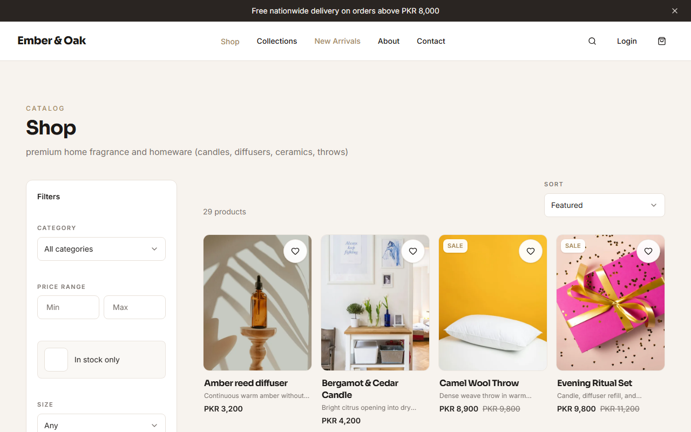
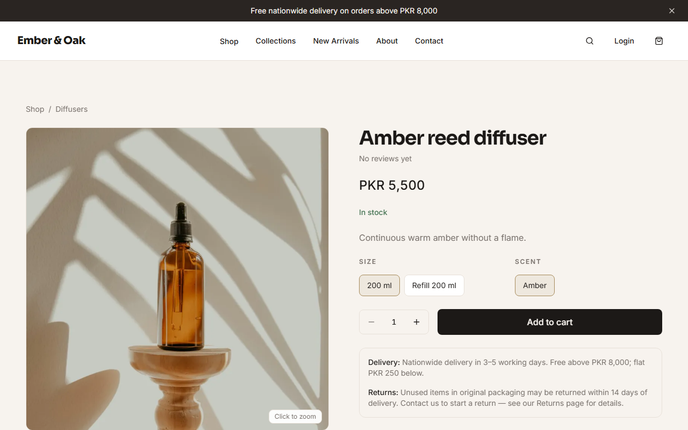
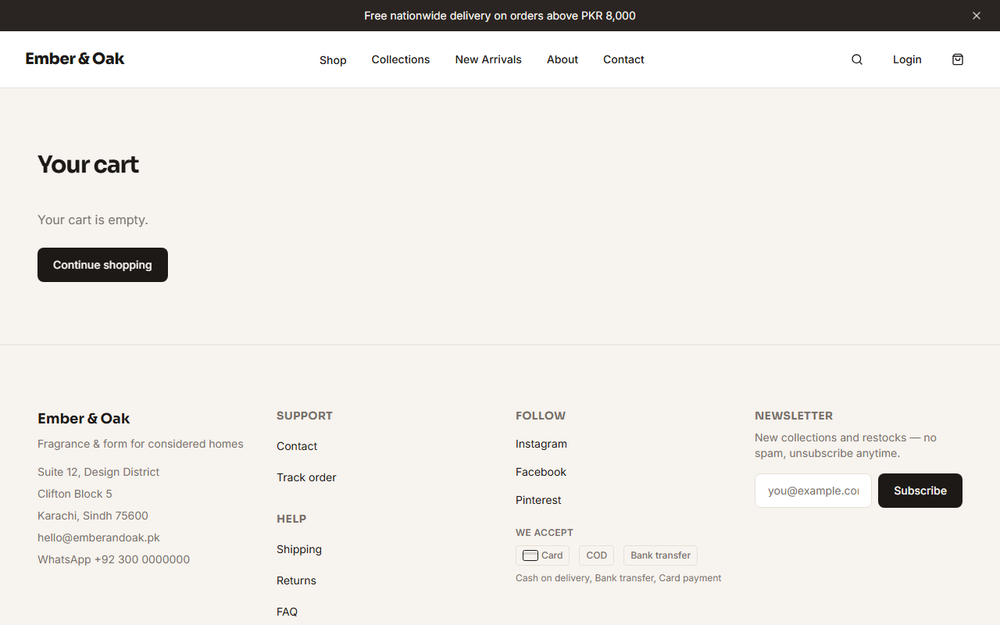
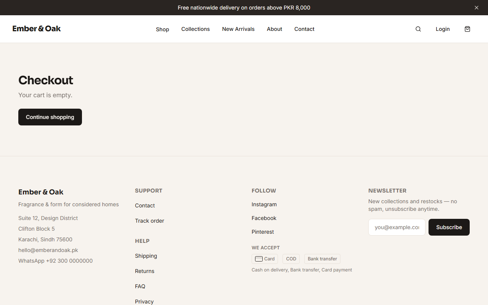
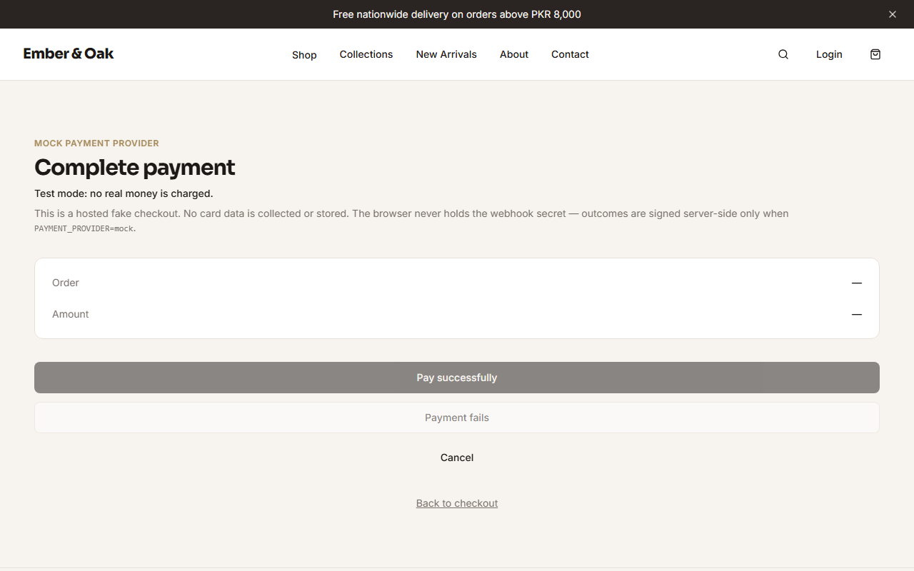
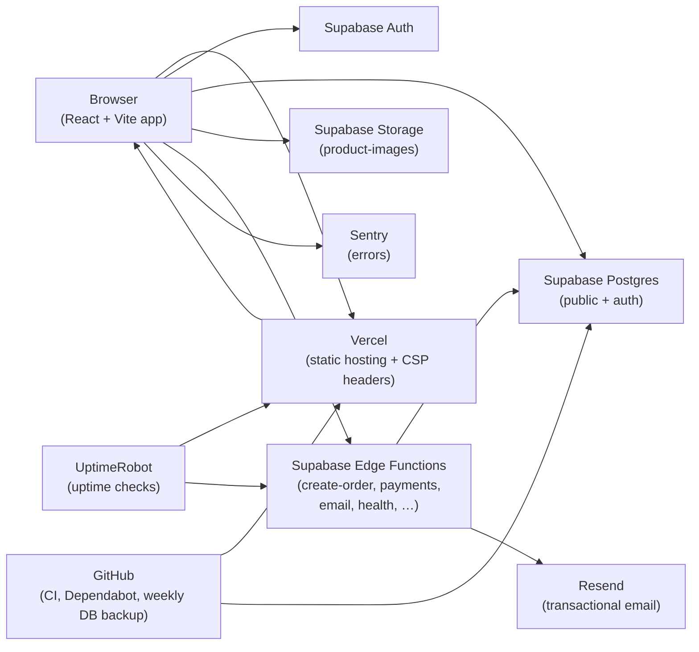

# Ember & Oak

Premium home fragrance and homeware storefront for Pakistan — a portfolio demo with a real checkout flow, admin panel, and mocked card payments.

**Live demo:** [https://ember-oak-beige.vercel.app](https://ember-oak-beige.vercel.app)

> **Demo note:** Card payments use a mock provider. No real money is charged. Stock, orders, and email are real against Supabase for the demo project.

## Screenshots

| Home | Shop | Product |
|:----:|:----:|:-------:|
|  |  |  |

| Cart | Checkout | Mock checkout |
|:----:|:--------:|:-------------:|
|  |  |  |

Regenerate with `npm run screenshots` (set `QA_BASE_URL` to override the live site).

## Features

- Catalog: categories, collections, filters, search, bestsellers, related products
- Cart, wishlist, guest + signed-in checkout (COD, bank transfer, mock card)
- Server-side order creation with stock locking and price recalculation
- Order confirmation, tracking, transactional email outbox
- Admin: products, inventory, orders, discounts, reviews, messages, newsletter, settings
- Contact form, newsletter, SEO (canonical, OG, robots, sitemap)
- Error monitoring (Sentry, deferred load) and CI on every push

## Tech stack

- **Frontend:** React 19, TypeScript, Vite 8, Tailwind CSS v4, React Router 7, TanStack Query
- **UI:** Radix primitives, Lucide, Sonner, Embla carousel
- **Backend:** Supabase (Postgres + Auth + Storage + Edge Functions)
- **Hosting:** Vercel
- **Observability:** Sentry (optional), UptimeRobot (optional)
- **Email:** Resend via Edge Functions / outbox
- **Testing:** Vitest, Playwright (live QA), Lighthouse scripts

## Architecture



Full write-up: [docs/ARCHITECTURE.md](docs/ARCHITECTURE.md).

## Security highlights

- **Row Level Security** on catalog, orders, profiles, admin tables — anon clients cannot escalate
- **Atomic orders with stock locking** via Edge Function / RPC (not browser inserts)
- **Rate limiting** on checkout and sensitive public endpoints
- **Signed webhooks** for payment status (mock provider verifies signatures in demo mode)
- **Server-side price calculation** — cart totals are recomputed from DB prices and discounts

## Testing and CI

| Command | Purpose |
|---------|---------|
| `npm run lint` | oxlint |
| `npm run typecheck` | `tsc -b` |
| `npm test` | Vitest unit tests |
| `npm run build` | SEO gen + typecheck + production bundle |
| `npm run test:e2e` | Playwright |
| `npm run test:qa` | Live QA harness against `QA_BASE_URL` |
| `npm run lighthouse:qa` | Mobile Lighthouse (home, shop, product) |
| `npm run images:check` | Request every demo image URL |

GitHub Actions (`.github/workflows/ci.yml`) runs lint, typecheck, tests, and build on every push/PR to `main`.

Performance notes: [docs/PERFORMANCE.md](docs/PERFORMANCE.md).

## Run it locally

```bash
npm install
cp .env.example .env   # optional — works offline with local catalog
npm run dev
```

Without Supabase env vars the app uses the **local demo catalog** (`src/data/catalog.ts`). Cart, checkout, contact, and newsletter persist in `localStorage`.

With Supabase:

1. Apply migrations under `supabase/migrations/`, then `supabase/seed.sql`
2. Set `VITE_SUPABASE_URL` and `VITE_SUPABASE_PUBLISHABLE_KEY` in `.env`
3. Deploy Edge Functions (`create-order`, payments, email, …) and set function secrets
4. Never put the service role key in `VITE_*` vars

Store copy and delivery rules live in [`src/config/store.ts`](src/config/store.ts).

### Demo data reset

After QA or demos leave junk orders behind, run [`supabase/demo_reset.sql`](supabase/demo_reset.sql) manually (see comments at the top of that file). Exact steps are listed at the end of this README’s deploy notes in the agent response / below:

1. Open the Supabase Dashboard → **SQL Editor**
2. Paste the full contents of `supabase/demo_reset.sql`
3. Run it (it is wrapped in `BEGIN` … `COMMIT`)
4. Or via CLI: `psql "$DATABASE_URL" -v ON_ERROR_STOP=1 -f supabase/demo_reset.sql`

It clears test commerce/CRM noise and resets stock to seed values; it keeps catalog, discounts, settings, and user accounts.

## Image tooling

```bash
npm run images:optimize   # WebP srcset + compressed JPG/OG
npm run images:check      # Fail on missing/broken image URLs
```
