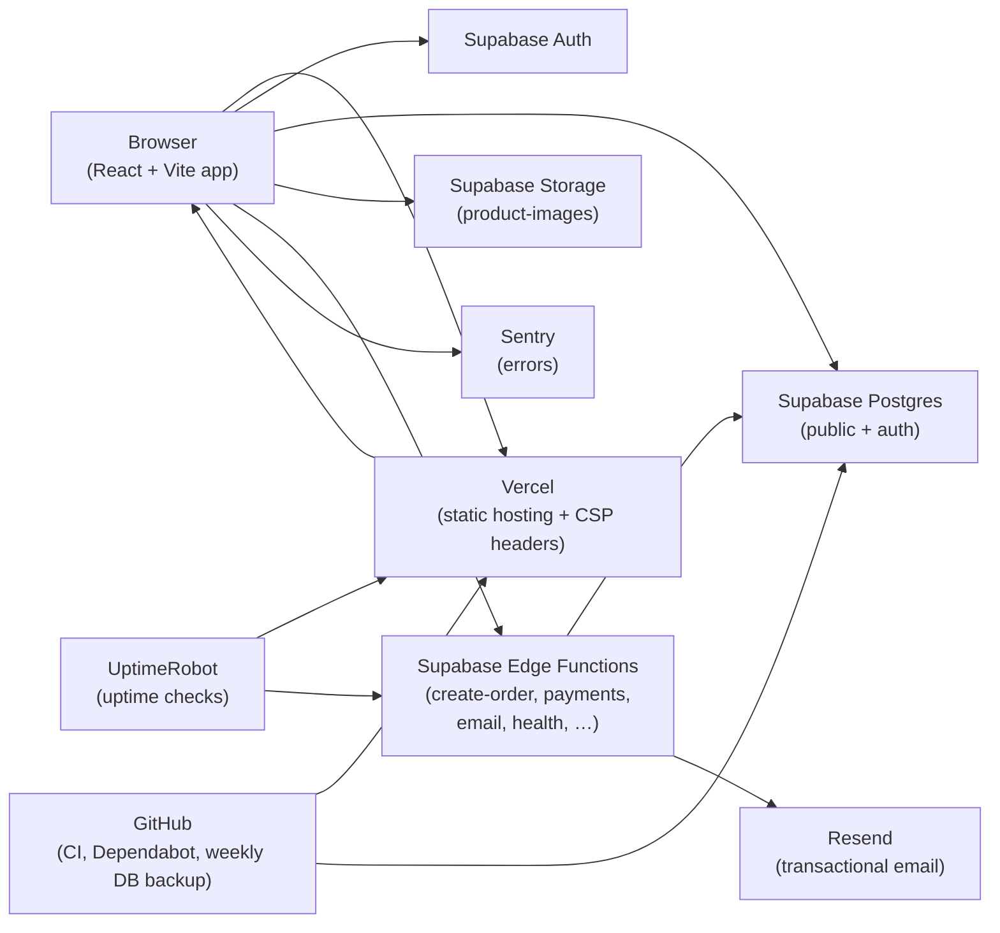

# Architecture (Ember & Oak)

Plain-language map of how the store fits together for a solo owner.

## System diagram

**Flow in one sentence:** shoppers load the site from Vercel; the browser talks to Supabase for catalog/auth/images and calls Edge Functions for checkout, payments, email, and health; Resend sends mail; Sentry catches JS errors; UptimeRobot pings the site and health; GitHub runs CI and weekly `pg_dump` backups.

## Main tables (public schema)

| Area | Tables |
|------|--------|
| Catalog | `products`, `product_variants`, `product_images`, `categories`, `collections`, `collection_products` |
| Commerce | `orders`, `order_items`, `payments`, `discount_codes`, `stock_history` |
| Content / CRM | `reviews`, `contact_messages`, `newsletter_subscribers` (if present), `addresses`, `wishlists`, `profiles` |
| Ops | `settings`, `email_outbox`, `app_events`, `rate_limits` |

Auth users live in Supabase **Auth** (`auth.users`); `profiles` mirrors app fields and `is_admin`.

## Permission model (who can read / write)

| Actor | Can read | Can write |
|-------|----------|-----------|
| **Anonymous visitor** | Active products, categories, collections, approved reviews, public settings, public product images | Contact form, newsletter subscribe, guest checkout via Edge Functions (rate-limited) |
| **Signed-in customer** | Own profile, addresses, orders, wishlist | Own profile/addresses/wishlist; place orders |
| **Admin** (`profiles.is_admin`) | Admin lists (products, inventory, orders, reviews, messages, events) via RLS / admin RPCs | Product CRUD, stock, order status, refunds, review moderation, discounts, settings |
| **Edge Functions (service role)** | Full DB as needed for checkout, payments, email outbox, health | Create orders/payments, adjust stock, enqueue emails, write `app_events` / `rate_limits` — never exposed to the browser |
| **Storage `product-images`** | Public read of product photos | Upload/delete only for authenticated admins (policies in migrations) |

Row Level Security (RLS) enforces the above in Postgres. Sensitive actions (moderate review, refund) go through SECURITY DEFINER RPCs or Edge Functions so the anon key cannot escalate.

## Related docs

- [RESTORE.md](./RESTORE.md) — restore a dump into a new project  
- [RUNBOOK.md](./RUNBOOK.md) — incidents and secret rotation  
- [SCALING.md](./SCALING.md) — free-tier limits and upgrade order  
- [LAUNCH_CHECKLIST.md](./LAUNCH_CHECKLIST.md) — go-live gaps  
- [MONITORING.md](./MONITORING.md) — Sentry / UptimeRobot setup  
